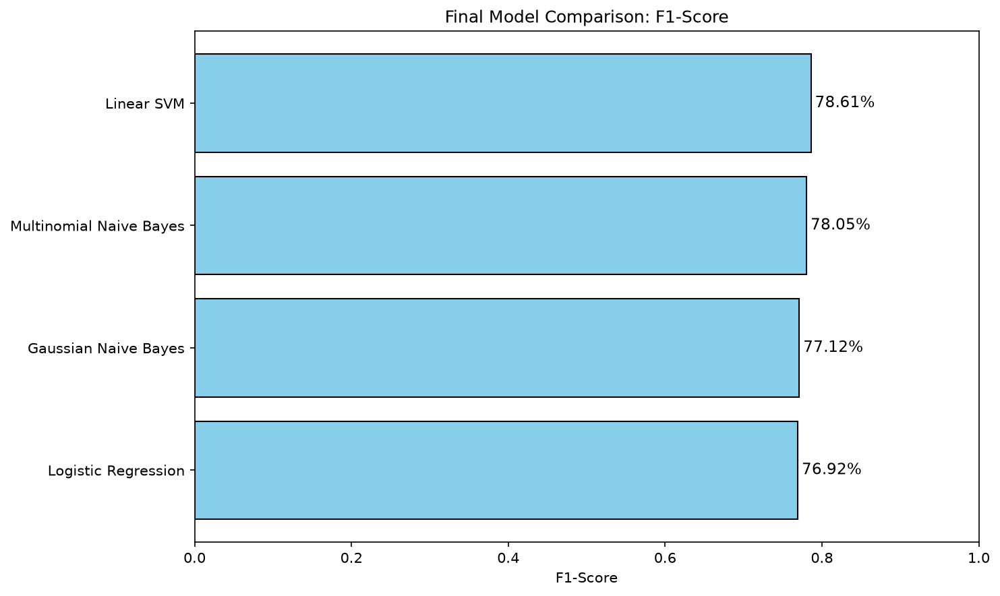

# Restaurant Reviews Sentiment Analysis

A Natural Language Processing (NLP) project that classifies restaurant reviews as positive or negative using the Bag of Words model and compares multiple Machine Learning classifiers.

## Overview

This project demonstrates a complete NLP pipeline, from raw text preprocessing to model training and rigorous evaluation. It covers text cleaning, stemming, stopword removal, feature extraction using the Bag of Words technique, and a comparative analysis of four different classification algorithms.

The goal is to build a reliable model that can automatically determine the sentiment of a customer review, which can be applied to automate customer feedback monitoring and business intelligence.

## Dataset

- **Name:** Restaurant Reviews
- **Source:** Machine Learning A-Z (Udemy)
- **File:** `data/Restaurant_Reviews.tsv`
- **Format:** Tab-Separated Values (TSV)
- **Size:** 1,000 reviews
- **Features:** `Review` (text), `Liked` (0 for negative, 1 for positive)

## Methodology

The pipeline follows these key steps:

1. **Data Loading:** Loaded the TSV file using `pandas` with `delimiter='\t'` and `quoting=3` to correctly handle text data containing commas and quotes.
2. **Text Preprocessing:** 
   - Removed non-letter characters (punctuation and numbers) using Regular Expressions.
   - Converted all text to lowercase for consistency.
   - Split reviews into individual words.
   - Applied Porter Stemming to reduce words to their root forms (e.g., "loved" to "love").
   - Removed stopwords, except for "not", which is crucial for sentiment analysis.
3. **Feature Extraction:** Used `CountVectorizer` with `max_features=1500` to keep only the 1,500 most frequent words, converting the text into a sparse matrix.
4. **Rigorous Evaluation Strategy:** 
   - The dataset was split into an **80% Training set** and a **20% Test set**. The test set was locked away and not used during the tuning phase to prevent data leakage.
   - **Grid Search** was performed exclusively on the Training set to find the best hyperparameters (using 10-Fold Cross-Validation).
   - The final models were evaluated **once** on the unseen Test set to provide an unbiased, real-world estimate of performance. The models were ranked by **F1-Score** to ensure a balance between Precision and Recall.

## Model Comparison and Results

Four classifiers were tuned and evaluated on the unseen 20% Test set. 



| Model | Accuracy | Precision | Recall | F1-Score | Best Parameters |
| :--- | :--- | :--- | :--- | :--- | :--- |
| **Linear SVM** | **78.50%** | **80.61%** | 76.70% | **78.61%** | `C=1` |
| Multinomial Naive Bayes | 77.50% | 78.43% | 77.67% | 78.05% | `alpha=1.0` |
| Gaussian Naive Bayes | 73.00% | 68.42% | 88.35% | 77.12% | N/A |
| Logistic Regression | 77.50% | 81.52% | 72.82% | 76.92% | `C=1` |

### Key Findings:
1. **Linear SVM** achieved the highest F1-Score (78.61%) on the unseen test data, proving it generalizes best to new reviews. Grid Search found that `C=1` was optimal.
2. **Gaussian Naive Bayes** achieved a high Recall (88.35%) but a very poor Precision (68.42%). This means it predicted positive for almost every review, resulting in a massive number of false positives. F1-Score correctly penalized this, proving why Accuracy alone is misleading.
3. **Rigorous Testing Prevented Overfitting:** During the tuning phase, Logistic Regression appeared to be the strongest model. However, when tested on the completely unseen 20% holdout set, its performance dropped, revealing it had slightly overfit the training data. The Linear SVM proved to be the most robust.

## Project Structure

```text
restaurant-reviews-nlp/
|
|-- data/
|   |-- Restaurant_Reviews.tsv
|
|-- outputs/
|   |-- model_comparison.png
|
|-- src/
|   |-- nlp_pipeline.py
|
|-- .gitignore
|-- README.md
|-- requirements.txt
```

## How to Run

1. Clone the repository:
```bash
git clone https://github.com/agonselmani/restaurant-reviews-nlp.git
cd restaurant-reviews-nlp
```

2. Install the required dependencies:
```bash
pip install -r requirements.txt
```

3. Run the Python pipeline script. This script will clean the data, tune the models using Grid Search, evaluate them on the 20% holdout test set, and save the comparison chart:
```bash
python src/nlp_pipeline.py
```

## Requirements

The project requires the following Python libraries (available in `requirements.txt`):
- numpy
- pandas
- scikit-learn
- nltk
- matplotlib

## Author

Agon Selmani
- GitHub: [agonselmani](https://github.com/agonselmani)