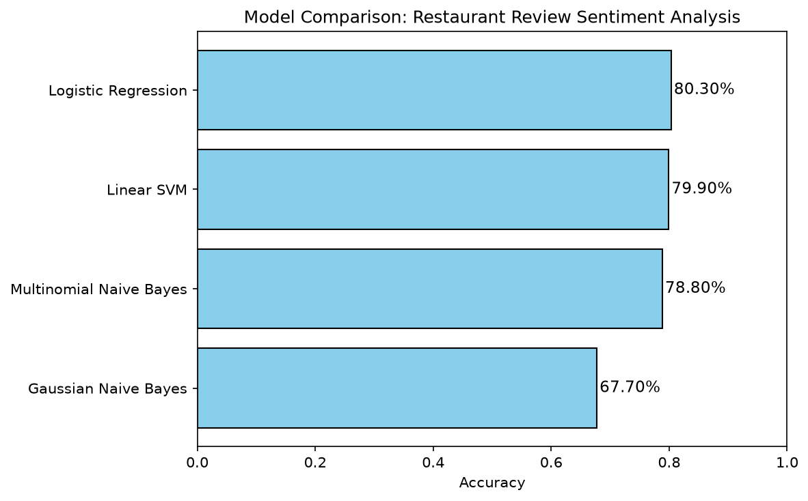

# Restaurant Reviews Sentiment Analysis

A Natural Language Processing (NLP) project that classifies restaurant reviews as positive or negative using the Bag of Words model and compares multiple Machine Learning classifiers.

## Overview

This project demonstrates a complete NLP pipeline, from raw text preprocessing to model training and robust evaluation. It covers text cleaning, stemming, stopword removal, feature extraction using the Bag of Words technique, and a comparative analysis of four different classification algorithms.

The goal is to build a reliable model that can automatically determine the sentiment of a customer review, which can be applied to automate customer feedback monitoring and business intelligence.

## Dataset

- **Name:** Restaurant Reviews
- **Source:** Machine Learning A-Z (Udemy)
- **File:** `data/Restaurant_Reviews.tsv`
- **Format:** Tab-Separated Values (TSV)
- **Size:** 1,000 reviews
- **Features:** `Review` (text), `Liked` (0 for negative, 1 for positive)

## Methodology

The pipeline follows these key steps:

1. **Data Loading:** Loaded the TSV file using `pandas` with `delimiter='\t'` and `quoting=3` to correctly handle text data containing commas and quotes.
2. **Text Preprocessing:** 
   - Removed non-letter characters (punctuation and numbers) using Regular Expressions.
   - Converted all text to lowercase for consistency.
   - Split reviews into individual words.
   - Applied Porter Stemming to reduce words to their root forms (e.g., "loved" to "love").
   - Removed stopwords, except for "not", which is crucial for sentiment analysis.
3. **Feature Extraction:** Used `CountVectorizer` with `max_features=1500` to keep only the 1,500 most frequent words, converting the text into a sparse matrix.
4. **Evaluation Strategy:** The dataset was evaluated using two methods:
   - A single 80/20 Train/Test Split to generate Confusion Matrices.
   - 10-Fold Cross-Validation to ensure the final model rankings are statistically robust and not due to random chance.

## Model Comparison and Results

Four classifiers were evaluated. The final ranking is based on the 10-Fold Cross-Validation results, as they provide the most reliable estimate of real-world performance.



| Model | 10-Fold CV Accuracy | Key Takeaway |
| :--- | :--- | :--- |
| **Logistic Regression** | **80.30%** | Winner. Best performance on sparse text data with built-in regularization. |
| Linear SVM | 79.90% | Extremely close second. Highly effective for high-dimensional data. |
| Multinomial Naive Bayes | 78.80% | Strong performance. Validates the theory that it is the correct NB variant for text. |
| Gaussian Naive Bayes | 67.70% | Lowest performance. The single train/test split gave a lucky 73%, but CV revealed its true lower accuracy due to incorrect distribution assumptions. |

### Key Findings:
1. **Logistic Regression** achieved the highest average accuracy across all 10 folds, making it the most reliable model for this dataset.
2. **Multinomial Naive Bayes** outperformed **Gaussian Naive Bayes** by over 11%. This confirms the mathematical theory: MultinomialNB is designed for discrete word counts, while GaussianNB assumes continuous, normally distributed data.
3. **Cross-Validation proved crucial:** The initial single train/test split gave GaussianNB a lucky score (73.00%), but the 10-Fold CV exposed its true, unstable nature (67.70%). 

## Project Structure

```text
restaurant-reviews-nlp/
|
|-- data/
|   |-- Restaurant_Reviews.tsv
|
|-- outputs/
|   |-- model_comparison.png
|
|-- src/
|   |-- nlp_pipeline.py
|
|-- .gitignore
|-- README.md
|-- requirements.txt
```

## How to Run

1. Clone the repository:
```bash
git clone https://github.com/your-username/restaurant-reviews-nlp.git
cd restaurant-reviews-nlp
```

2. Install the required dependencies:
```bash
pip install -r requirements.txt
```

3. Run the Python pipeline script. Note: This script will train the models, print evaluation metrics to the console, and automatically save the comparison chart to the `outputs/` folder:
```bash
python src/nlp_pipeline.py
```

## Requirements

The project requires the following Python libraries (available in `requirements.txt`):
- numpy
- pandas
- scikit-learn
- nltk
- matplotlib

## Author

Agon
- GitHub: [agonselmani](https://github.com/agonselmani)

## Acknowledgements

- Kirill Eremenko and Hadelin de Ponteves for the Machine Learning A-Z course.
- The open-source community for NLTK and scikit-learn.
```

